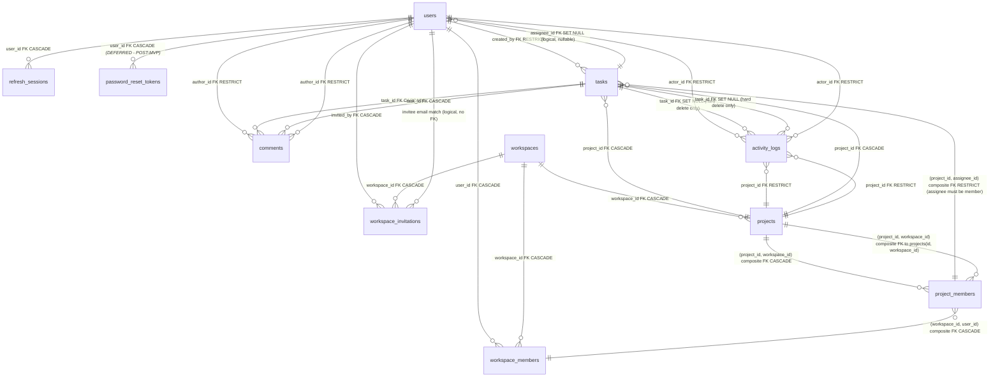

# DevFlow — Entity Relationship Diagram (Mermaid)

## Table Relationships Summary

| Parent | Child | FK Column(s) | Referenced Table | Referenced Columns | On Delete | Cardinality | Type |
|--------|-------|--------------|------------------|-------------------|-----------|-------------|------|
| users | refresh_sessions | user_id | users | id | CASCADE | 1:N | DB FK |
| users | password_reset_tokens | user_id | users | id | CASCADE | 1:N | DB FK (POST-MVP / Deferred) |
| users | workspace_members | user_id | users | id | CASCADE | 1:N | DB FK |
| users | workspace_invitations | invited_by | users | id | CASCADE | 1:N | DB FK |
| users | tasks | created_by | users | id | RESTRICT | 1:N | DB FK |
| users | tasks | assignee_id | users | id | SET NULL | 1:N (optional) | DB FK |
| users | comments | author_id | users | id | RESTRICT | 1:N | DB FK |
| users | activity_logs | actor_id | users | id | RESTRICT | 1:N | DB FK |
| workspaces | workspace_members | workspace_id | workspaces | id | CASCADE | 1:N | DB FK |
| workspaces | workspace_invitations | workspace_id | workspaces | id | CASCADE | 1:N | DB FK |
| workspaces | projects | workspace_id | workspaces | id | CASCADE | 1:N | DB FK |
| projects | project_members | (project_id, workspace_id) | projects | (id, workspace_id) | CASCADE | 1:N | DB composite FK |
| projects | tasks | project_id | projects | id | CASCADE | 1:N | DB FK |
| projects | activity_logs | project_id | projects | id | RESTRICT | 1:N | DB FK |
| workspace_members | project_members | (workspace_id, user_id) | workspace_members | (workspace_id, user_id) | CASCADE | 1:N | DB composite FK |
| project_members | tasks | (project_id, assignee_id) | project_members | (project_id, user_id) | RESTRICT | 1:N | DB composite FK |
| tasks | comments | task_id | tasks | id | CASCADE | 1:N | DB FK |
| tasks | activity_logs | task_id | tasks | id | SET NULL | 1:N | DB FK (hard delete only) |

## Composite Foreign Keys

| FK Table | FK Columns | References Table | Referenced Columns | On Delete | Purpose |
|----------|------------|------------------|-------------------|-----------|---------|
| project_members | (project_id, workspace_id) | projects | (id, workspace_id) | CASCADE | Project member's workspace matches project's workspace |
| project_members | (workspace_id, user_id) | workspace_members | (workspace_id, user_id) | CASCADE | Project member must be a workspace member |
| tasks | (project_id, assignee_id) | project_members | (project_id, user_id) | RESTRICT | Task assignee must be a project member |

**Prerequisites:** `projects` has UNIQUE `(id, workspace_id)`; `project_members` has UNIQUE `(project_id, user_id)`; `workspace_members` has UNIQUE `(workspace_id, user_id)` (referenced target for `project_members` composite FK).

## Single-Column Foreign Keys with SET NULL

| Table | Column | References | On Delete | Rationale |
|-------|--------|------------|-----------|-----------|
| tasks | assignee_id | users(id) | SET NULL | User deletion clears assignee reference; separate from composite FK to project_members |
| activity_logs | task_id | tasks(id) | SET NULL | Applies only to hard deletion; task soft-delete preserves `task_id` |

## Composite Foreign Keys with RESTRICT

| Table | FK Columns | References | On Delete | Rationale |
|-------|------------|------------|-----------|-----------|
| tasks | (project_id, assignee_id) | project_members(project_id, user_id) | RESTRICT | Assignee must be a project member; RESTRICT prevents deleting membership with assigned tasks |

## Partial Unique Indexes

| Table | Columns | Condition | Purpose |
|-------|---------|-----------|---------|
| workspace_members | workspace_id | `WHERE role = 'owner'` | At most one Owner per workspace |
| refresh_sessions | (revoked_at, expires_at) | `WHERE revoked_at IS NULL` | Active session lookup; expiration checked in query |
| workspace_invitations | (accepted_at, revoked_at, expires_at) | `WHERE accepted_at IS NULL AND revoked_at IS NULL` | Pending invitation validation; expiration checked in query |
| workspaces | id | `WHERE deleted_at IS NULL` | Active workspace lookup |
| projects | id | `WHERE deleted_at IS NULL` | Active project lookup |
| tasks | (project_id, status) | `WHERE deleted_at IS NULL` | Kanban/dashboard queries excluding deleted |
| tasks | assignee_id | `WHERE deleted_at IS NULL` | My assigned tasks excluding deleted |
| tasks | due_date | `WHERE deleted_at IS NULL AND status != 'done'` | Overdue task queries |
| comments | (task_id, created_at) | `WHERE deleted_at IS NULL` | Ordered comment listing excluding deleted |

## Workspace Hard Deletion Behavior

Hard deletion (`DELETE FROM workspaces`) cascades to `workspace_members`, `workspace_invitations`, and `projects` (via ON DELETE CASCADE). However, foreign key constraints do NOT unconditionally block workspace hard deletion:
- **Activity logs referencing projects:** If any project in the workspace has activity logs, project deletion is blocked by `activity_logs.project_id ON DELETE RESTRICT`, halting the workspace deletion.
- **Assigned tasks referencing project members:** If any project member in the workspace has assigned tasks (active or soft-deleted), cascading deletion of `workspace_members` to `project_members` is blocked by `tasks(project_id, assignee_id) ON DELETE RESTRICT`.
- **Cascade behavior depends on existing dependent records:** If a workspace has no activity logs and no assigned tasks (e.g. an empty workspace), `DELETE FROM workspaces` cascades and deletes all child records (`projects`, `project_members`, `workspace_members`, `workspace_invitations`, `tasks`, `comments`).
- **Soft deletion remains normal behavior:** In normal application operation, workspaces are soft-deleted / archived (`deleted_at = now()`), preserving all workspace records, memberships, projects, tasks, and audit logs. Hard deletion is an administrative operation only. Application logic must not claim an unconditional FK guarantee against workspace hard deletion.

## Notes

- UUID PKs throughout.
- `projects.key varchar(10) NOT NULL`, UNIQUE `(workspace_id, key)`, immutable after creation; used as task identifier prefix.
- `tasks.identifier varchar(30) NOT NULL`, UNIQUE `(project_id, identifier)`: stores project-scoped identifier formatted as `"{key}-{LPAD(counter::text, GREATEST(3, LENGTH(counter::text)), '0')}"` (e.g. `DEV-001`, `DEV-999`, `DEV-1000`), ensuring minimum 3-digit zero-padding without truncating identifiers beyond 999; `varchar(30)` safely accommodates 10-char keys + hyphen + counter up to PostgreSQL int max (2,147,483,647) with headroom.
- `projects` has UNIQUE `(id, workspace_id)` to support composite FK references.
- `workspace_members` and `project_members`: UNIQUE `(workspace_id, user_id)` / `(project_id, user_id)`.
- At most one Owner per workspace enforced by partial unique index `workspace_members(workspace_id) WHERE role = 'owner'`. Owner voluntary departure requires transferring ownership to an eligible Admin, unassigning tasks across projects, and removing membership in a single atomic transaction (§8.15 of DATABASE_SPECIFICATION.md).
- `project_members` does not have a direct foreign key to `users(id)`: referential integrity and cascade deletion are fully mediated by the composite FK `(workspace_id, user_id) → workspace_members(workspace_id, user_id) ON DELETE CASCADE`, eliminating redundant constraint checks and duplicate cascade execution paths.
- `activity_logs` is append-only (no `updated_at` or `deleted_at`); normal users cannot modify.
- Soft delete: `deleted_at` on workspaces, projects, tasks, comments.
- Task soft-delete preserves `task_id` in activity_logs; `ON DELETE SET NULL` applies only to hard deletion.
- Invitation token and refresh token stored as hashes, never plaintext (password reset token hash design deferred to post-MVP).
- Password hash stored (`password_hash`), never plaintext.
- Logical (non-FK) associations: workspace_invitations.email → accepting user's email (validated at application layer).
