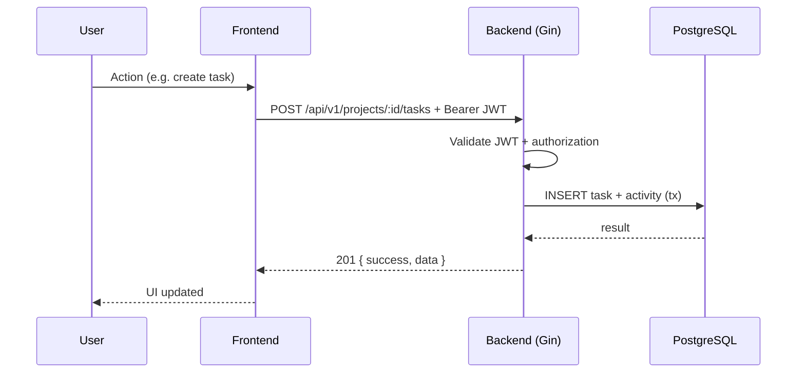
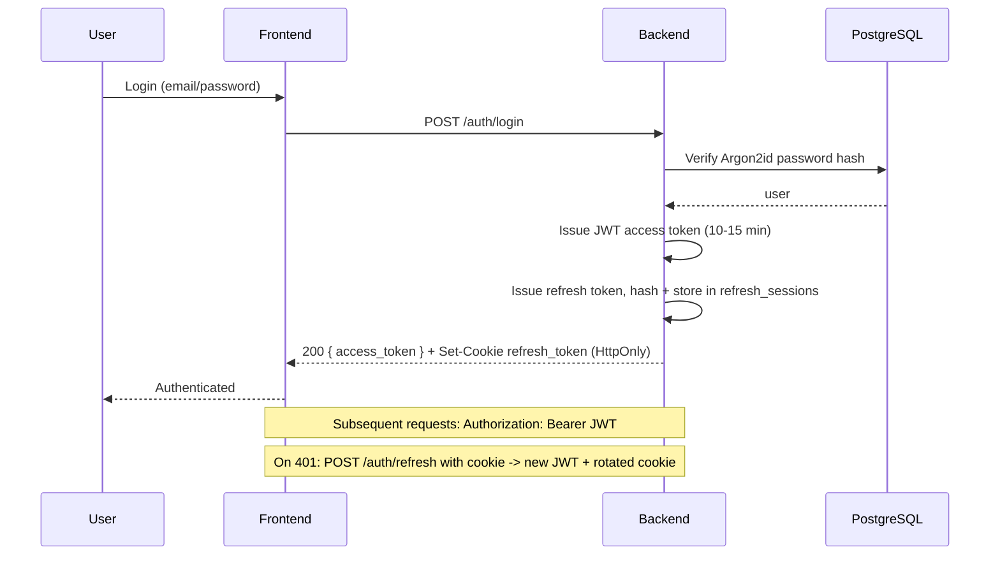
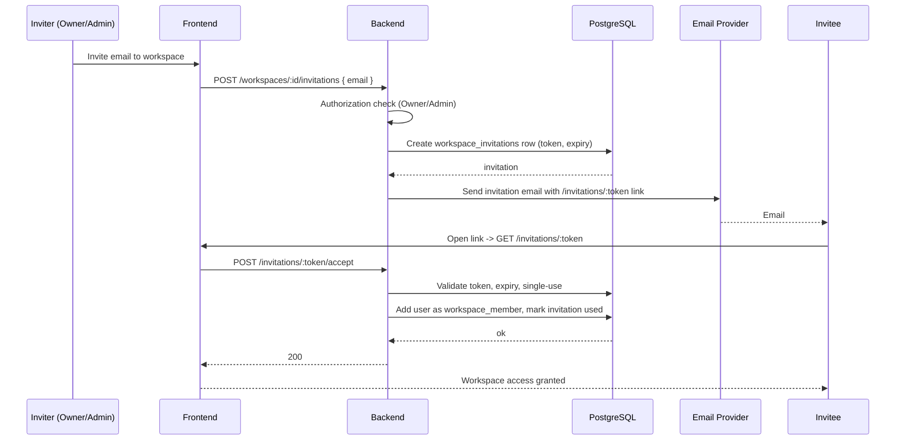
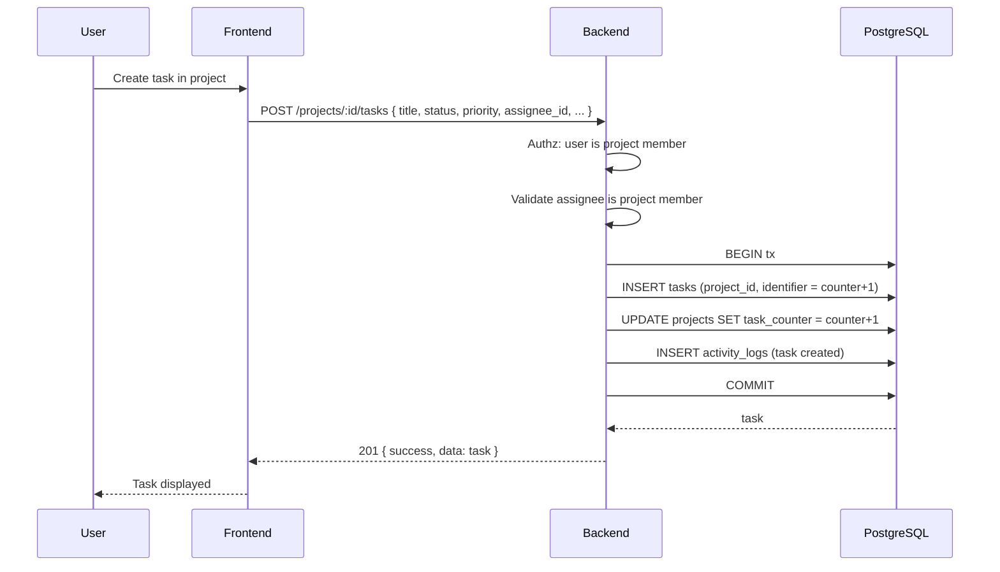
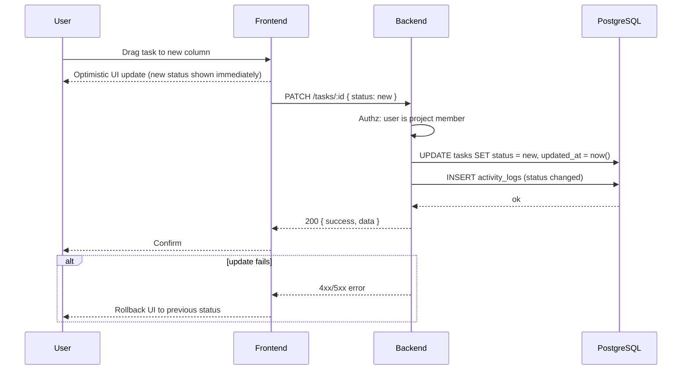

# DevFlow — System Architecture

## 1. Architecture Overview

DevFlow uses a **modular monolith backend** and a **feature-based frontend**. The frontend and backend are separate deployments communicating over HTTPS via a versioned REST API (`/api/v1`).

- Frontend: Vercel (SPA, React + Vite)
- Backend: Dockerized Go/Gin app on VPS/Cloud
- Database: Managed PostgreSQL
- Auth: JWT access token (memory) + rotating refresh token (HttpOnly cookie)

No microservices for the MVP.

## 2. Frontend Architecture

### Application Structure

```
frontend/
├── index.html
├── main.tsx
├── vitest.setup.ts
├── src/
│   ├── app/                  # Router, providers, global layout
│   │   ├── router.tsx        # TanStack Router or React Router
│   │   ├── providers.tsx     # QueryClient, auth, toast
│   │   └── routes/           # Route definitions with guards
│   ├── features/             # Feature-based modules
│   │   ├── auth/
│   │   ├── workspace/
│   │   ├── projects/
│   │   ├── tasks/
│   │   ├── comments/
│   │   └── dashboard/
│   │       ├── api.ts        # API client calls (TanStack Query)
│   │       ├── components/   # Feature-specific UI components
│   │       ├── hooks.ts      # Feature hooks (only when justified)
│   │       ├── schema.ts     # Zod validation schemas
│   │       └── types.ts      # Feature TypeScript types
│   ├── entities/             # Shared domain types (user, task, project, workspace)
│   ├── shared/               # Reusable UI (shadcn wrappers), lib, utils
│   │   ├── ui/               # shadcn/ui components
│   │   ├── lib/              # api client, query client, auth storage
│   │   └── utils.ts
│   └── pages/                # Route-level page components (compose feature components)
```

### Routing

- Client-side routing with route guards for authentication.
- Public routes: `/auth/login`, `/auth/register`.
- Protected routes: everything else; redirect to login if unauthenticated.
- Workspace scoping: `/workspaces/:workspaceId/...`, `/projects/:projectId/...`.

### Authentication State

- Access token stored in frontend memory (JavaScript variable), not localStorage.
- Refresh token handled automatically by the API client via HttpOnly cookie (browser manages).
- API client intercepts 401 responses: attempts refresh once; on retry failure, clears state and redirects to login.
- Auth state exposed via a lightweight context/provider.

### Server State Management

- TanStack Query for all server state (queries + mutations).
- Consistent query keys per feature, e.g. `['tasks', projectId]`, `['workspaces']`.
- Mutations invalidate relevant queries on success.
- `staleTime`, `gcTime`, and retry policies configured per feature.

### Client State Management

- Minimal. Use React `useState`/`useReducer` for UI-only state (modals, drafts, drag state).
- No global client-state library (Redux/Zustand) unless justified later.

### API Communication

- Typed fetch/axios wrapper with base URL from env.
- Request: inject `Authorization: Bearer <access token>` header.
- Response: consistent envelope `{ success, data, meta }` / `{ success, error }`.
- 401 handling with refresh rotation as described.

### Form Validation

- React Hook Form + Zod for schema validation.
- Zod schemas shared per feature; validated client-side before submission and again server-side.

### Error Handling

- API errors normalized to the envelope format.
- Toast notifications for user-facing errors.
- Field-level errors from Zod mapped to form errors.
- Unexpected errors logged (no secrets) and shown as generic messages.

### Loading States

- TanStack Query `isLoading` / `isFetching` for queries.
- Mutation `isPending` for submissions.
- Skeleton placeholders for lists; spinners for actions.

### Reusable Components

- shadcn/ui base (Button, Input, Dialog, DropdownMenu, etc.).
- Reuse only when genuinely shared across features (Button, Input, Modal, EmptyState, Badge).
- No business logic inside UI components; components receive data and callbacks via props.

### Feature Module Boundaries

Initial modules: `auth`, `workspace`, `projects`, `tasks`, `comments`, `dashboard`.
- `entities` holds shared types (User, Project, Task, Workspace).
- `shared` holds UI primitives and the API client.
- Features do not import each other's internal logic; they communicate via shared entities and the API client.
- `comments` is a sub-feature of `tasks` (comments belong to tasks) but kept as its own module folder.

### Additional Modules Evaluation

None required beyond the six listed. `comments` is task-scoped; `dashboard` is read-only aggregation. No separate `kanban` module — Kanban is a view within `tasks`.

## 3. Backend Architecture

### Layered Structure

```
backend/
├── cmd/server/               # Entry point
├── internal/
│   ├── config/               # Environment config (viper or stdlib)
│   ├── middleware/           # Auth, logging, CORS, CSRF, rate limiting, recovery
│   ├── handlers/             # HTTP handlers (Gin) — thin, delegate to use cases
│   │   ├── auth/
│   │   ├── workspace/
│   │   ├── project/
│   │   ├── task/
│   │   ├── comment/
│   │   ├── activity/
│   │   └── dashboard/
│   ├── usecases/             # Application / business logic (one per feature)
│   │   ├── auth/
│   │   ├── workspace/
│   │   ├── project/
│   │   ├── task/
│   │   ├── comment/
│   │   └── activity/
│   ├── domain/               # Domain models + business rules (pure Go, no framework)
│   │   └── errors.go
│   ├── repository/           # Data access (sqlc-generated queries + custom repo)
│   │   ├── queries.sql       # sqlc source
│   │   ├── db.go             # sqlc Queries wrapper
│   │   └── tx.go             # transaction helper
│   ├── mail/                 # Email interface (implementation TBD)
│   └── auth/                 # Token hashing, password hashing, JWT utilities
├── api/
│   └── openapi.yaml          # OpenAPI spec
├── migrations/               # golang-migrate SQL migrations (created in Sprint 1)
├── go.mod / go.sum
└── Dockerfile
```

### Dependency Direction

```
handlers -> usecases -> domain
       |         |
       v         v
middleware   repository -> database
```

- Handlers depend on usecases.
- Usecases depend on domain models and repository interfaces.
- Repository depends on sqlc-generated code and pgx.
- No usecase imports handlers. No handler imports repository directly.
- Dependency injection via constructor functions (no DI framework).

### Transaction Handling

- Multiple repositories in one usecase operation share a single `pgx.Tx`.
- A `Tx` helper opens a transaction, passes it to repository methods, commits on success, rolls back on error.
- Example: task creation inserts `tasks` row, increments project task counter, writes `activity_logs` — all in one transaction.
- Read-only usecases may run without a transaction.

### Concurrency

- `context.Context` propagated from handler → usecase → repository.
- Request timeouts set at middleware layer.
- Database operations use `pgxpool` with bounded connection pool.

### What Is NOT Built

- No DI framework (wire/fx).
- No event bus / message queue for MVP.
- No Redis unless a measured need arises.

## 4. Mermaid Diagrams

### 4.1 High-Level System Architecture

```mermaid
graph TD
    User((User)) -->|HTTPS| FE[Frontend<br/>React + Vite<br/>Vercel]
    FE -->|REST /api/v1| BE[Backend<br/>Go + Gin<br/>Docker on VPS]
    BE --> DB[(PostgreSQL<br/>Managed)]
    BE --> Mail[(Email Provider<br/>TBD)]
    User -.->|Access token (memory)| FE
    FE -.->|Refresh token cookie| BE
    BE -->|JWT verify| BE
```

### 4.2 Frontend ↔ Backend Communication



### 4.3 Authentication Flow



### 4.4 Invitation Flow



### 4.5 Task Creation and Assignment Flow



### 4.6 Kanban Status Update Flow



## 5. Configuration

Backend config from environment variables:
- `DATABASE_URL` (pgx connection string)
- `PORT` (HTTP server port)
- `JWT_SECRET` (access token signing)
- `JWT_TTL` (access token lifetime, default 15m)
- `REFRESH_TOKEN_COOKIE_NAME`, `COOKIE_DOMAIN`, `COOKIE_SECURE`, `COOKIE_SAME_SITE`
- `BCRYPT/ARGON2ID` parameters
- `FRONTEND_URL` (CORS allowlist)
- `RATE_LIMIT_LOGIN`, `RATE_LIMIT_REFRESH`

Frontend config:
- `VITE_API_BASE_URL`
- `VITE_AUTH_STORAGE` (memory only for access token)

No secrets hardcoded.

## 6. Additional Dependencies

No new dependencies beyond the fixed stack are proposed at this time. Any future addition must satisfy the four-question dependency test (Section 2 of master prompt).
